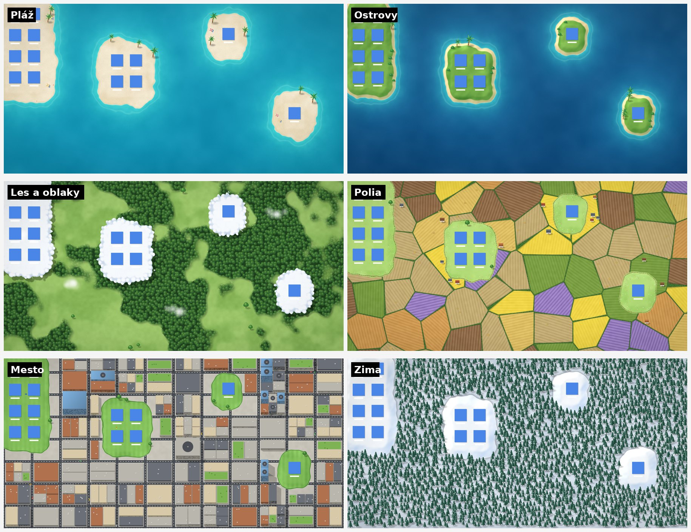

# Krajinka (macOS) – prototyp

Živá tapeta pre macOS v maľovanom štýle. Prečíta, kde ležia ikony na ploche,
a pod dokumentmi vytvorí iný povrch než v okolí: piesok uprostred mora,
oblaky nad lesom, pastvinu medzi poliami, park v meste alebo snehovú pláň
v ojínenom lese. Blízke dokumenty zdieľajú spoločnú oblasť. Mimo dokumentov
takáto oblasť nikdy nevznikne.



| Téma | Pod dokumentmi | Okolie | Pohyb (Metal shader) |
|---|---|---|---|
| Pláž | krémový piesok | tyrkysové more | príboj vybieha na piesok a ustupuje, piesok za ním vysychá; vlny sa lámu na penu; kaustiky; odlesky slnka; tiene oblakov |
| Ostrovy | tráva s plážou, stromy | hlbšie more | ako Pláž + vietor v tráve |
| Les a oblaky | kopovité oblaky | les a lúky zhora | vlny vetra v tráve, pohupovanie korún, tiene oblakov |
| Polia | pastvina s kvetmi | parcely plodín, živé ploty | vietor, tiene oblakov |
| Mesto | park | ulice, domy a mrakodrapy, stromy | tiene oblakov, vietor v parku |
| Zima | snehová pláň | ojínený les | sneh v troch hĺbkach, trblietky snehu |

Animácie počíta Metal shader (`LiveShader.swift`) na GPU v 30 snímkach za
sekundu. Keď je plocha zakrytá, pozastaví sa. Shader sa kompiluje pri
spustení, takže stačia Command Line Tools. Ak by kompilácia zlyhala,
Krajinka ukáže statický obraz a chybu zapíše do
`~/Library/Logs/Krajinka/shader-chyba.txt`.

V menu je navyše prepínač **Chodníky medzi dokumentmi**.

> Náhľady vyrenderoval `tools/terrain_preview.py` (numpy + cairo). Simuláciu
> animácií do videa robí `tools/animation_preview.py`. Obe slúžia na ladenie
> bez Macu a vzhľad aplikácie zachytávajú približne.

## Požiadavky

- macOS 13 Ventura alebo novší
- Xcode alebo len *Command Line Tools* (`xcode-select --install`), Swift 5.9+

## Zostavenie a spustenie

```bash
cd krajinka-mac
./build.sh
open build/Krajinka.app
```

Pri prvom spustení si macOS vypýta prístup **Accessibility**: Systémové
nastavenia → Súkromie a bezpečnosť → Prístupnosť → zapnúť *Krajinka*.
Bez tohto povolenia sa krajina vykreslí, ale ikony nepozná.

> Pri ad-hoc podpise (predvolený v `build.sh`) považuje macOS každý nový build
> za inú aplikáciu. Po prebuildovaní treba *Krajinku* v zozname Prístupnosti
> odstrániť (–) a pridať znova, alebo podpisovať stabilnou identitou:
> `SIGN_IDENTITY="Apple Development: …" ./build.sh`.

Ovládanie je cez ikonu hôr v menu bare: téma, pozastavenie, prekreslenie,
spúšťanie pri prihlásení, diagnostika a ukončenie.

## Architektúra

| Súbor | Úloha |
|---|---|
| `KrajinkaApp.swift` | vstupný bod, aplikácia len v menu bare (`.accessory`) |
| `AppDelegate.swift` | správa monitorov, rozdeľovanie ikon, pozastavovanie, menu |
| `ScreenScene.swift` | `DesktopWindow` (okno na úrovni tapety) a scéna jednej obrazovky s renderom na pozadí |
| `SceneView.swift` | strom vrstiev Core Animation: vlny, hladina, lodičky, oblaky, vtáky, motýle, sneh |
| `Terrain.swift` | výškové pole (šum + vplyv ikon), pixelový render a masky |
| `Paths.swift` | chodníky medzi ikonami (minimálna kostra), mosty cez vodu |
| `Decorator.swift` | rozmiestnenie a kreslenie flóry a drobností mimo ikon a chodníkov |
| `Theme.swift` | palety a pravidlá tém (Pláž, Lúka, Zima) |
| `DesktopIcons.swift` | čítanie polôh ikon z Findera (Accessibility API) a polling |
| `SceneAssets.swift` | kódom generované sprity: oblaky, vtáky, plachetnica, kačky, motýle, vločky |

**Ako to funguje:**
1. **Okno pod ikonami.** Na každom monitore je bezrámové okno na úrovni
   `kCGDesktopWindowLevel + 1`. Je nad systémovou tapetou a pod ikonami
   Findera, na všetkých Spaces, a kliknutia prepúšťa ďalej.
2. **Ikony.** Raz za sekundu, a len keď je plocha viditeľná, sa z Findera
   prečítajú rámčeky prvkov `AXImage` pod jeho `AXScrollArea` (plocha).
   **Názvy súborov sa nečítajú.**
3. **Terén.** Výškové pole v mriežke 6 bodov má tri zložky:
   - fBm šum,
   - „kopčeky“ okolo ikon,
   - garanciu ostrova a tesnej čistinky pod každou ikonou.

   Z poľa sa počíta **vzdialenosť od pobrežia v bodoch** (signed distance
   field: subpixelové semienka + chamfer). Vďaka nej majú pláže, plytčiny,
   podvodný prah, biely lem aj vlny rovnakú šírku okolo každého ostrova.
   Reliéf je tieňovaný svetlom zhora zľava. Na snehu sú tiene modrasté.
   Pridaná je jemná vinetácia podľa pomeru strán a zrno.
4. **Chodníky a flóra.** Ikony spája minimálna kostra chodníkov. Úseky cez
   vodu sú drevené mostíky s doskami a zábradlím. Flóra rastie v hájoch podľa
   šumu, mäkké tiene padajú doprava dole a všetko sa vyhýba ikonám
   aj chodníkom.
5. **Plynulá zmena.** Keď sa ikony zmenia, nový obraz sa vypočíta na pozadí
   a prelína sa so starým 0,9 s. Dekorácie sú deterministické podľa mriežky,
   takže stromy „neskáču“. Len pribúdajú alebo miznú. Lodičky a kačky
   zostávajú na mieste, kým je tam voda.
6. **Animácie.** Všetko pohyblivé beží v Core Animation (GPU):
   - vlny: štyri prstencové masky v hĺbke 6, 12, 19 a 27 bodov sa
     rozsvecujú postupne zvonka dnu, potom sa spení breh,
   - iskry na hladine (`CAReplicatorLayer`) a záblesky slnka (`CAEmitterLayer`),
   - oblaky s tieňom,
   - kŕdle vtákov v tvare V s tieňom,
   - plachetnice s brázdou alebo kačky s káčatkami (`rotationMode = .rotateAuto`),
   - motýle na uzavretých Catmull-Rom dráhach,
   - sneh v dvoch hĺbkach.

   Snímková frekvencia je obmedzená na 15–30 fps.
7. **Úspora.** Animácie sa zastavia, keď je okno zakryté
   (`occlusionState`), keď je aktívna aplikácia na celú obrazovku, keď
   obrazovky spia a v režime nízkej spotreby.

## Widescreen / ultrawide

- **Každý monitor má vlastné okno a vlastnú scénu.** Pri pripojení či
  odpojení monitora alebo pri zmene rozlíšenia sa scéna prestavia
  (`didChangeScreenParametersNotification`).
- **Nič sa nenaťahuje.** Šum, dekorácie aj oblaky sú v logických bodoch.
  Monitor 32:9 jednoducho zobrazí väčší kus sveta.
  - Počet oblakov a dĺžka ich preletu rastú so šírkou, rýchlosť zostáva
    rovnaká.
  - Mriežky iskier sa replikujú podľa šírky.
- **Rozpočet pixelov.** Render ide v Retina hustote, kde je to lacné. Na
  veľkých plochách, napr. 5120×1440, je strop približne 6 Mpx na
  prekreslenie. Core Animation ho potom zväčší.
- **Viac monitorov.** Finder vracia polohy ikon v globálnom priestore cez
  všetky monitory. `AppDelegate.distributeIcons()` ich prepočíta do
  lokálnych súradníc konkrétnej obrazovky.

## Čo treba overiť na reálnom Macu

Kód vznikol bez možnosti kompilácie (Linux prostredie). Na Macu treba overiť:

1. **Kompiláciu.** `./build.sh`. Prípadné drobné chyby prekladu treba opraviť.
2. **Strom Accessibility Findera.** Predpoklad je, že ikony sú prvky
   `AXImage` pod `AXScrollArea`. Ak menu ukáže „Ikony na ploche: 0“, hoci
   ikony na ploche sú, použi *Uložiť diagnostiku ikon…*. Súbor
   `~/Library/Logs/Krajinka/diagnostika-ikon.txt` ukáže skutočnú štruktúru
   a stačí upraviť `iconRoles` v `DesktopIcons.swift`.
3. **Úroveň okna.** Na macOS 14+ s widgetmi na ploche treba overiť, že
   okno neprekrýva widgety.
4. **Rozsah rámčeka ikony.** Treba zistiť, či AX rámček zahŕňa aj popisok.
   Kód aj tak pridáva rezervu.

## Ďalšie kroky (roadmap)

- `AXObserver` namiesto 1 s pollingu, aby bola reakcia na presun ikony okamžitá.
- Viac tém: noc so svetluškami, púšť, mesto.
- Tematické zóny naprieč ultrawide (napr. vľavo pláž, vpravo les).
- Podpis Developer ID a notarizácia na distribúciu. App Store nie je
  vhodný, lebo sandbox nedovolí čítať Finder.

## Právna poznámka

Projekt je samostatná implementácia s vlastným názvom, kódom a procedurálne
generovanou grafikou. Nepreberá kód, grafiku ani značku iných produktov.
