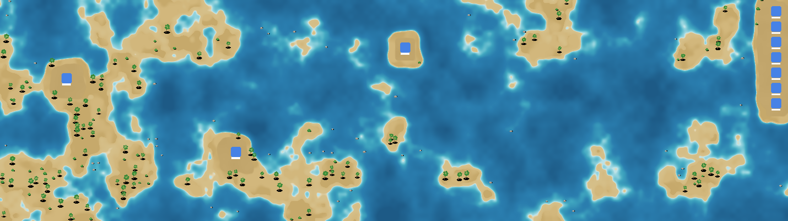
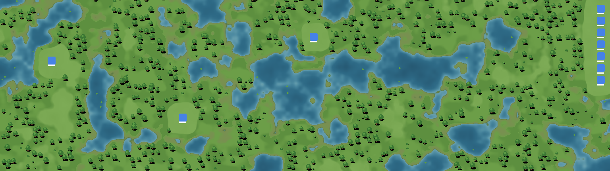
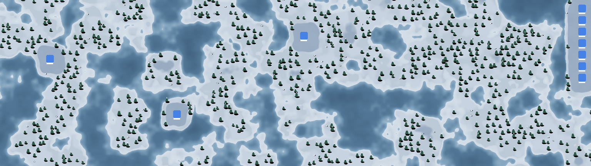
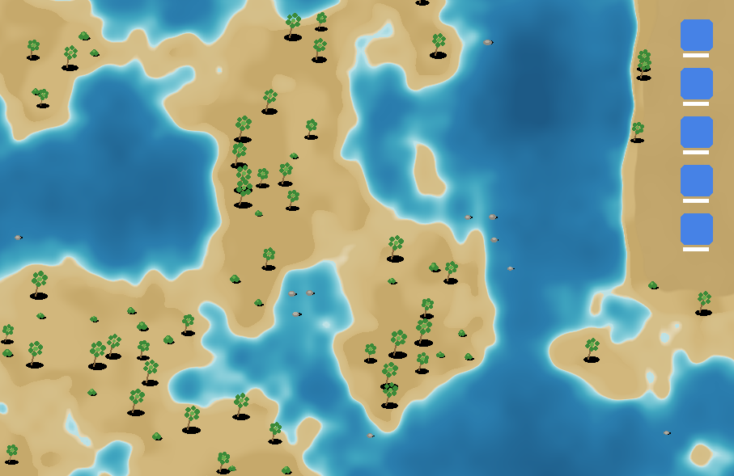

# Krajinka (macOS) – prototyp

Živá tapeta pre macOS. Prečíta, kde ležia ikony na ploche, a nechá okolo nich
vyrásť krajinu: ostrovy v mori, lúku s jazierkami alebo zasneženú tajgu.
Ikony vždy stoja na pokojnej čistinke. Stromy, palmy a kamene sa im vyhýbajú.



| Lúka | Zima | MacBook (Pláž) |
|---|---|---|
|  |  |  |

> Náhľady vyrenderoval `tools/terrain_preview.py`. Je to verný prepis algoritmu
> terénu do Pythonu, slúži na ladenie tém bez Macu. Modré štvorce simulujú
> ikony. V aplikácii sú navyše animácie: pena pri brehu, iskry na vode,
> tiene oblakov a sneženie.

## Požiadavky

- macOS 13 Ventura alebo novší
- Xcode alebo len *Command Line Tools* (`xcode-select --install`), Swift 5.9+

## Zostavenie a spustenie

```bash
cd krajinka-mac
./build.sh
open build/Krajinka.app
```

Pri prvom spustení si macOS vypýta prístup **Accessibility**: Systémové
nastavenia → Súkromie a bezpečnosť → Prístupnosť → zapnúť *Krajinka*.
Bez tohto povolenia sa krajina vykreslí, ale ikony nepozná.

> Pri ad-hoc podpise (predvolený v `build.sh`) považuje macOS každý nový build
> za inú aplikáciu. Po prebuildovaní treba *Krajinku* v zozname Prístupnosti
> odstrániť (–) a pridať znova, alebo podpisovať stabilnou identitou:
> `SIGN_IDENTITY="Apple Development: …" ./build.sh`.

Ovládanie je cez ikonu hôr v menu bare: téma, pozastavenie, prekreslenie,
spúšťanie pri prihlásení, diagnostika a ukončenie.

## Architektúra

| Súbor | Úloha |
|---|---|
| `KrajinkaApp.swift` | vstupný bod, aplikácia len v menu bare (`.accessory`) |
| `AppDelegate.swift` | správa monitorov, rozdeľovanie ikon, pozastavovanie, menu |
| `ScreenScene.swift` | `DesktopWindow` (okno na úrovni tapety) a scéna jednej obrazovky s renderom na pozadí |
| `SceneView.swift` | strom vrstiev Core Animation: terén, voda, pena, oblaky, sneh |
| `Terrain.swift` | výškové pole (šum + vplyv ikon), pixelový render a masky |
| `Decorator.swift` | rozmiestnenie a kreslenie dekorácií mimo ikon |
| `Theme.swift` | palety a pravidlá tém (Pláž, Lúka, Zima) |
| `DesktopIcons.swift` | čítanie polôh ikon z Findera (Accessibility API) a polling |
| `SceneAssets.swift` | generované bitmapy (iskry, tieň oblaku, vločka) |

**Ako to funguje:**
1. **Okno pod ikonami.** Na každom monitore je bezrámové okno na úrovni
   `kCGDesktopWindowLevel + 1`. Je nad systémovou tapetou a pod ikonami
   Findera, na všetkých Spaces, a kliknutia prepúšťa ďalej.
2. **Ikony.** Raz za sekundu, a len keď je plocha viditeľná, sa z Findera
   prečítajú rámčeky prvkov `AXImage` pod jeho `AXScrollArea` (plocha).
   **Názvy súborov sa nečítajú.**
3. **Terén.** Výškové pole v mriežke 6 bodov má tri zložky:
   - fBm šum,
   - „kopčeky“ okolo ikon,
   - garanciu čistinky pod každou ikonou.

   Pixely sa počítajú bilineárne, takže pobrežie je hladké v každom rozlíšení.
4. **Plynulá zmena.** Keď sa ikony zmenia, nový obraz sa vypočíta na pozadí
   a prelína sa so starým 0,9 s. Dekorácie sú deterministické podľa mriežky,
   takže stromy „neskáču“. Len pribúdajú alebo miznú.
5. **Animácie.** Všetko pohyblivé beží v Core Animation (GPU):
   - pulzujúca pena,
   - dve posúvajúce sa mriežky iskier (`CAReplicatorLayer`),
   - tiene oblakov,
   - sneh (`CAEmitterLayer`).

   Snímková frekvencia je obmedzená na 15–24 fps.
6. **Úspora.** Animácie sa zastavia, keď je okno zakryté
   (`occlusionState`), keď je aktívna aplikácia na celú obrazovku, keď
   obrazovky spia a v režime nízkej spotreby.

## Widescreen / ultrawide

- **Každý monitor má vlastné okno a vlastnú scénu.** Pri pripojení či
  odpojení monitora alebo pri zmene rozlíšenia sa scéna prestavia
  (`didChangeScreenParametersNotification`).
- **Nič sa nenaťahuje.** Šum, dekorácie aj oblaky sú v logických bodoch.
  Monitor 32:9 jednoducho zobrazí väčší kus sveta.
  - Počet oblakov a dĺžka ich preletu rastú so šírkou, rýchlosť zostáva
    rovnaká.
  - Mriežky iskier sa replikujú podľa šírky.
- **Rozpočet pixelov.** Render ide v Retina hustote, kde je to lacné. Na
  veľkých plochách, napr. 5120×1440, je strop približne 6 Mpx na
  prekreslenie. Core Animation ho potom zväčší.
- **Viac monitorov.** Finder vracia polohy ikon v globálnom priestore cez
  všetky monitory. `AppDelegate.distributeIcons()` ich prepočíta do
  lokálnych súradníc konkrétnej obrazovky.

## Čo treba overiť na reálnom Macu

Kód vznikol bez možnosti kompilácie (Linux prostredie). Na Macu treba overiť:

1. **Kompiláciu.** `./build.sh`. Prípadné drobné chyby prekladu treba opraviť.
2. **Strom Accessibility Findera.** Predpoklad je, že ikony sú prvky
   `AXImage` pod `AXScrollArea`. Ak menu ukáže „Ikony na ploche: 0“, hoci
   ikony na ploche sú, použi *Uložiť diagnostiku ikon…*. Súbor
   `~/Library/Logs/Krajinka/diagnostika-ikon.txt` ukáže skutočnú štruktúru
   a stačí upraviť `iconRoles` v `DesktopIcons.swift`.
3. **Úroveň okna.** Na macOS 14+ s widgetmi na ploche treba overiť, že
   okno neprekrýva widgety.
4. **Rozsah rámčeka ikony.** Treba zistiť, či AX rámček zahŕňa aj popisok.
   Kód aj tak pridáva rezervu.

## Ďalšie kroky (roadmap)

- `AXObserver` namiesto 1 s pollingu, aby bola reakcia na presun ikony okamžitá.
- Viac tém: noc so svetluškami, púšť, mesto.
- Tematické zóny naprieč ultrawide (napr. vľavo pláž, vpravo les).
- Podpis Developer ID a notarizácia na distribúciu. App Store nie je
  vhodný, lebo sandbox nedovolí čítať Finder.

## Právna poznámka

Projekt je samostatná implementácia s vlastným názvom, kódom a procedurálne
generovanou grafikou. Nepreberá kód, grafiku ani značku iných produktov.
